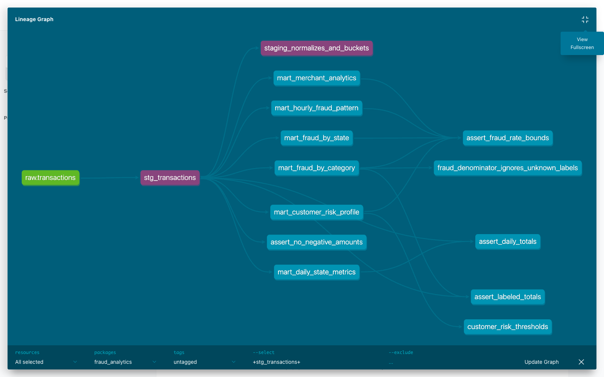

# ДЗ4 — dbt

Взяты train.csv и test.csv из [ДЗ2 по ClickHouse](https://github.com/chega8/sys_design_hse).
Исходная таблица — `transactions_db.transactions`, витрины создаются в базе `analytics`.

## Как запустить

Нужны Docker Compose и Python 3.9+. CSV в git нет, их надо положить в `data/`.

```bash
git clone https://github.com/chega8/sys_design_hse_hw4.git
cd sys_design_hse_hw4
mkdir -p data
# Скопировать train.csv и test.csv в data/
docker compose up -d --wait
python3 scripts/load_csv.py data/train.csv data/test.csv
cd dbt
python3 -m venv .venv
source .venv/bin/activate
pip install -r requirements.txt
make deps
make build
make lint
make docs
make serve
```

ClickHouse: localhost:8124, student/student. Docs: http://localhost:8082.
В `dbt/profiles.yml` можно поменять подключение через `CLICKHOUSE_HOST`,
`CLICKHOUSE_PORT`, `CLICKHOUSE_USER`, `CLICKHOUSE_PASSWORD`.
Скрипт загрузки использует `CLICKHOUSE_URL`, по умолчанию http://localhost:8124.

Данные загружаются прямо из CSV, без Kafka. Если те же файлы уже загружены,
скрипт сверяет количество строк и уникальных ключей и пропускает загрузку.
Это не сравнение содержимого файлов. Для замены данных или после прерванной
загрузки: `docker compose down -v`, затем повторить запуск и загрузку.

## Модели

`raw` (source) → `stg_transactions` → витрины.
В staging приводятся типы, убираются пробелы, нормализуется регистр, добавляются
дата, час, день недели и сегмент суммы через свой макрос `amount_bucket`.

| Витрина | Что считается |
| --- | --- |
| mart_daily_state_metrics | По дате и штату: количество, сумма, средний чек, P95, доля крупных покупок |
| mart_fraud_by_category | Количество транзакций и фродов, fraud_rate, суммы по категориям |
| mart_fraud_by_state | Фрод, суммы, уникальные клиенты и мерчанты по штатам |
| mart_customer_risk_profile | Первая и последняя покупка, число покупок, средний чек и риск клиента |
| mart_hourly_fraud_pattern | Количество и доля фрода по дням недели и часам UTC |
| mart_merchant_analytics | Оборот, средний чек, fraud_rate и флаг подозрительности мерчанта |

Крупная покупка — от 500. SMALL < 100, MEDIUM от 100 до 500 (не включая), LARGE от 500.
Риск клиента: HIGH от 5% фрода, MEDIUM от 1%, LOW ниже 1%, UNKNOWN без меток.
Подозрительный мерчант: хотя бы 100 размеченных транзакций и fraud_rate от 1%.
Пороги выбраны для этой работы, риск считается по всей доступной истории.

В test.csv нет target. Поэтому fraud_rate считается в процентах только среди
строк с известной меткой, иначе NULL. Оборот считается по всем строкам.
В данных нет customer_id: вместо него использован хеш имени, фамилии, улицы
и индекса. Это приближение. ID транзакции — имя файла и номер строки.

## Тесты и результат

Использованы dbt_utils (ключ клиента и составные ключи витрин), dbt_date
(день недели) и dbt_expectations (непустой staging). Для dbt_date добавлена
реализация дня недели под ClickHouse.

34 data tests: not_null, unique, accepted_values, уникальность ключей витрин,
проверка неотрицательных сумм, границ fraud_rate, сверка общих сумм и числа строк.
3 unit tests: очистка и границы сегментов суммы, расчёт fraud_rate с NULL,
границы риска клиента и случай без меток.

```bash
# Из dbt/, с активным окружением
make test
make lint
# Из корня репозитория
cd ..
pre-commit install
pre-commit run --all-files
```

Проверено на 1 048 575 строках: 786 431 с меткой и 262 144 без неё.
Все 37 тестов прошли. Показатели всех шести витрин также совпали с расчётом
напрямую из CSV. Логи и результаты: [dbt/results](dbt/results).
SQLFluff 3.4.2 не разбирает `quantileExact(0.95)(amount)`, поэтому на этой строке
оставлен локальный noqa. Модель проверяется при `dbt build`.

Версии: dbt-core 1.10.23, dbt-clickhouse 1.9.8, ClickHouse 25.3.3.42.


